

  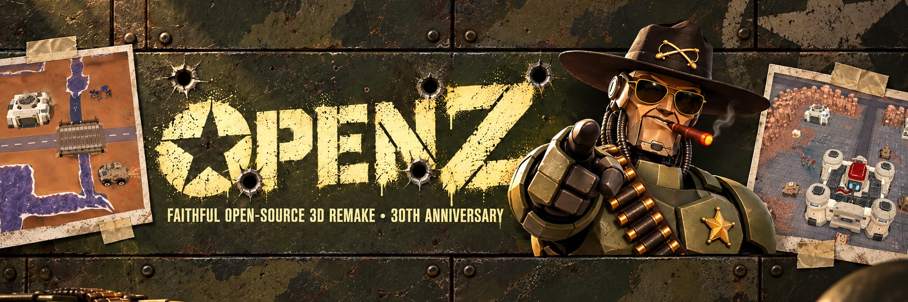

<h1 align="center">OpenZ</h1>

  <b>The faithful open-source 3D fan remake of Z (The Bitmap Brothers, 1996), made for its 30th anniversary.</b> 
  Free forever. Never sold. 100% original assets.

  
  
  
  
  

<h2 align="center">
  <a href="https://github.com/playopenz/OpenZ/releases/latest/download/OpenZ_1.0_win64.zip">⬇️ Download OpenZ for Windows (free, 1.4 GB)</a>
</h2>

  Unzip it, run <code>OpenZ.exe</code>, play. No install, no account, no launcher. 
  <a href="#-how-to-install">How to install</a> ·
  <a href="docs/CONTROLS.md">Controls</a> ·
  <a href="docs/SCREENSHOTS.md">Screenshots</a> ·
  <a href="https://docs.google.com/forms/d/e/1FAIpQLSfMuZs9-p1pCsRm59CQy4PBuZwE8VbOAJj_2TeER6gD3sf9ag/viewform?usp=sharing">Report a bug / send an idea</a>

---

## 🎬 Trailer

<!-- TRAILER -->

  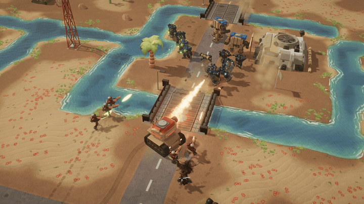

## 🤖 The legendary Z is 30. This is the remake we always wanted.

Hi guys! The legendary **Z** is celebrating its 30th anniversary, and to commemorate it, the community gets the
long-awaited faithful remake of the original Z, now in **full 3D**!

Every single detail has been meticulously recreated and restored with an almost ridiculous level of attention. Every
unit, robot, vehicle, building, interaction and gameplay stat has been faithfully reproduced, and then improved with
30 years of RTS game design experience. Even the smallest elements, down to the flora and fauna of each biome, are
there.

And that's not all: several completely new ideas and brand-new content have been added, including new units like the
**Mech** and the **Electrobot**! Every change from the original is listed in the game's **Changes & Updates** screen.

<table>
  <tr>
    <td width="50%">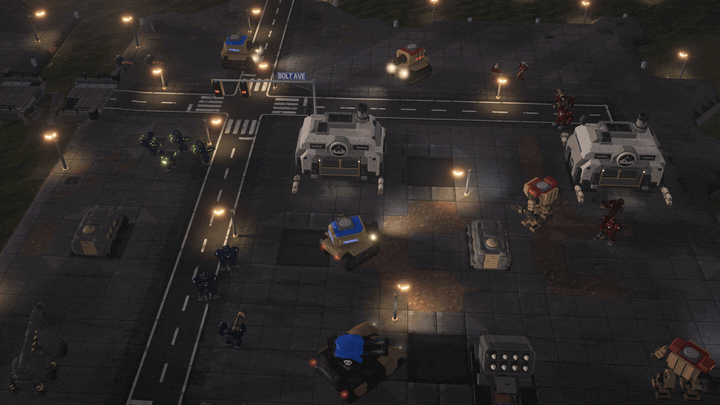</td>
    <td width="50%">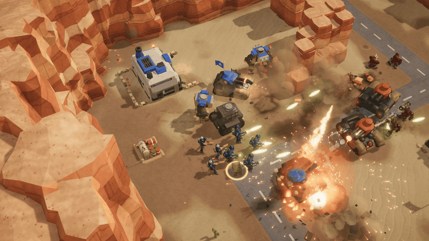</td>
  </tr>
  <tr>
    <td width="50%">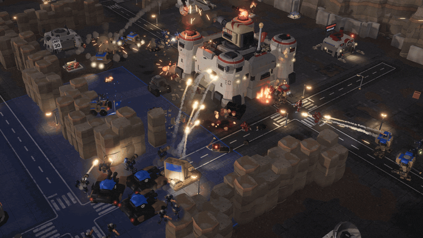</td>
    <td width="50%">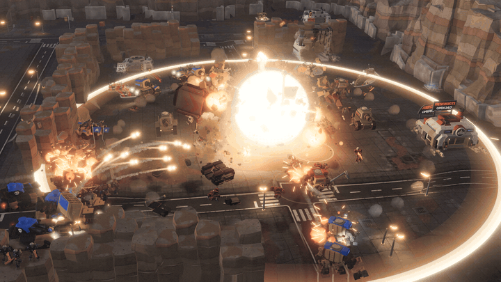</td>
  </tr>
</table>

## ⚔️ What's inside

- **Pure Z gameplay.** Capture flags to take whole territories. More territory means faster factories. Storm the enemy
  fort, or blow it to pieces. No resources to mine, no base building: just war.
- **Two classic levels, fully restored:** Level 2 (Desert) and Level 17 ("Car Park"), polished to an extreme level of
  detail, with day, night and weather.
- **The whole robot army:** Grunts, Psychos, Snipers, Toughs, Pyros and Lasers, plus the brand-new **Electrobot**.
- **Vehicles and guns:** jeeps, light, medium and heavy tanks, APCs, missile launchers, cranes, gatlings, howitzers,
  missile cannons, and the brand-new **Mech**. Any robot can board an empty vehicle, and a sniper can shoot the driver
  out of his seat.
- **A real opponent:** the CPU is ported from the open-source Zod Engine, with Easy, Medium and Hard difficulty.
- **Everything goes boom:** buildings break apart, bridges fall, wrecks burn, crews get thrown.
- **Modern comfort:** smooth zoom from a close tactical view out to the whole map, control groups, production queues,
  rally points, rebindable keys, game speed, 4K support.
- **The humour is back:** commander Zod and his robots have plenty to say.

## 📸 Screenshots

<table>
  <tr>
    <td width="50%"><a href="media/title.jpg">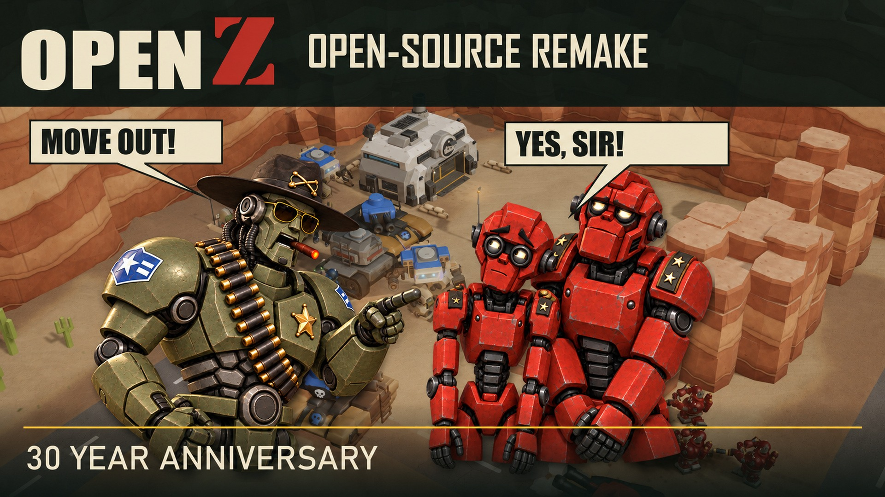</a></td>
    <td width="50%"><a href="media/screenshots/full/openz_screenshot_01.jpg">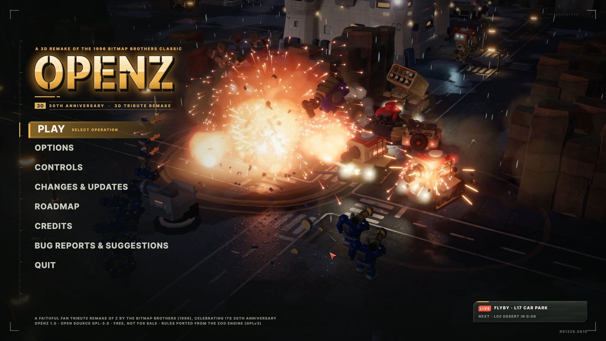</a></td>
  </tr>
  <tr>
    <td width="50%"><a href="media/screenshots/full/openz_screenshot_02.jpg">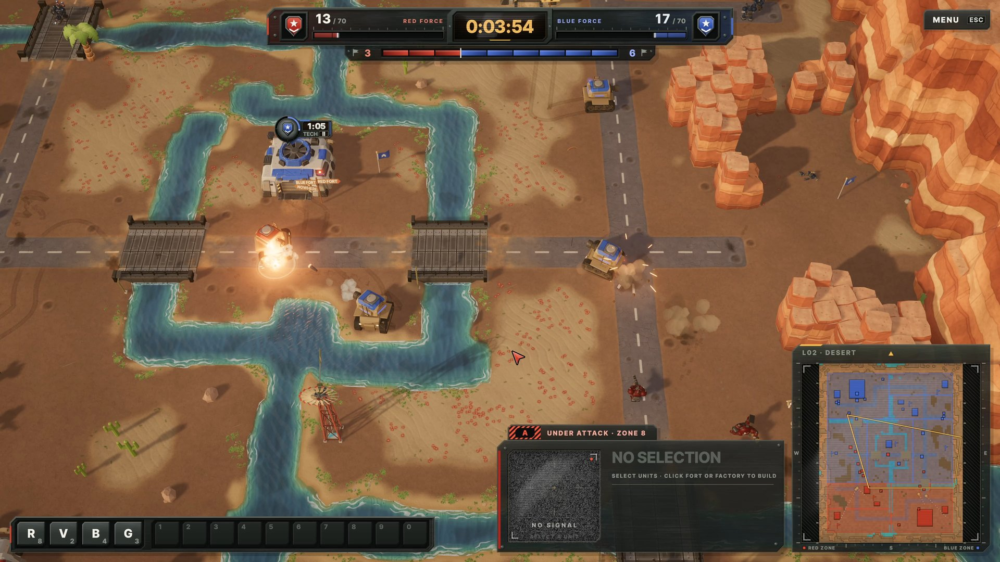</a></td>
    <td width="50%"><a href="media/screenshots/full/openz_screenshot_03.jpg">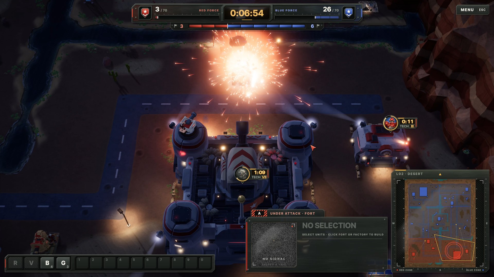</a></td>
  </tr>
  <tr>
    <td width="50%"><a href="media/screenshots/full/openz_screenshot_04.jpg">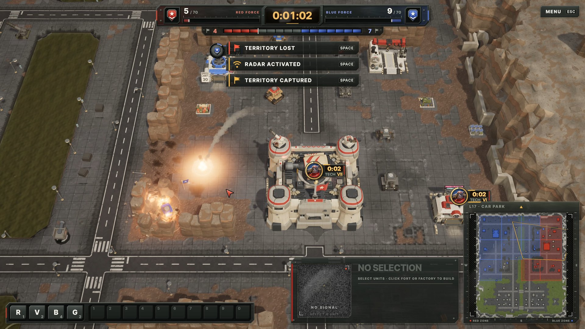</a></td>
    <td width="50%"><a href="media/screenshots/full/openz_screenshot_05.jpg">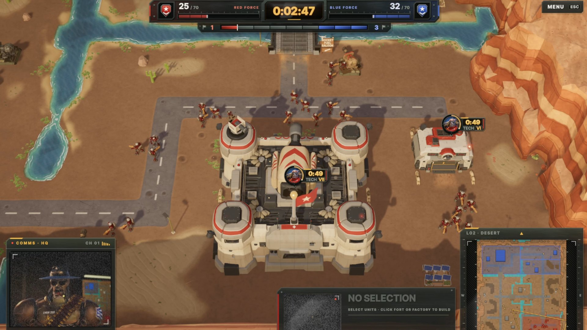</a></td>
  </tr>
  <tr>
    <td width="50%"><a href="media/screenshots/full/openz_screenshot_06.jpg">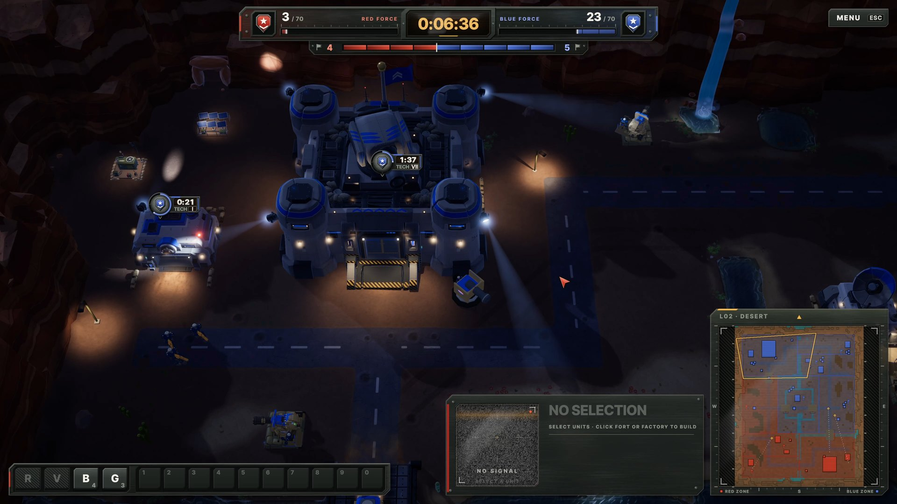</a></td>
    <td width="50%"><a href="media/screenshots/full/openz_screenshot_07.jpg">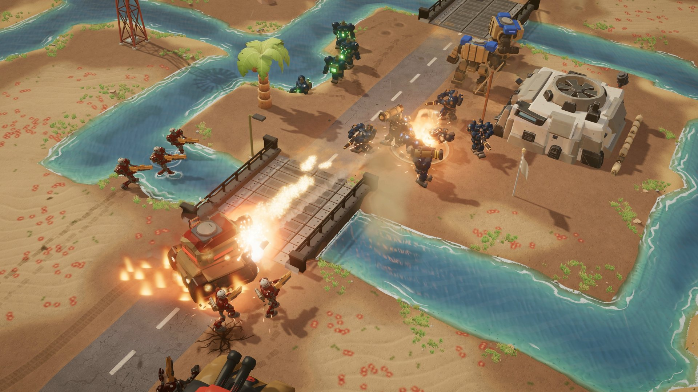</a></td>
  </tr>
</table>

<b><a href="docs/SCREENSHOTS.md">▶ More screenshots (all 28, in 4K)</a></b>

## 💾 How to install

1. **[Download OpenZ_1.0_win64.zip](https://github.com/playopenz/OpenZ/releases/latest/download/OpenZ_1.0_win64.zip)** (1.4 GB).
2. **Unzip it** anywhere (right click, *Extract All*).
3. **Run `OpenZ.exe`.** That's it.

> **Windows says "Windows protected your PC"?** Click **More info**, then **Run anyway**. It only appears because the
> game is not signed by a company. OpenZ sends nothing anywhere, and the full source code is right here.

**You need:** Windows 10 or 11 (64-bit), a DirectX 12 graphics card, about 3 GB of disk space.

**Want to be sure your download is the original?** The checksums are in
[RELEASE_SHA256.txt](https://github.com/playopenz/OpenZ/releases/latest/download/RELEASE_SHA256.txt). Check yours in
PowerShell: `Get-FileHash OpenZ_1.0_win64.zip -Algorithm SHA256`

**New to Z?** Read [how to play and all the controls](docs/CONTROLS.md), or open CONTROLS in the game's main menu.

## 📣 This is only the beginning

Together as a community we can bring Z back to its former glory: more restored classic levels, completely original
new levels, new units and maybe even multiplayer. **Your feedback shapes what comes next!** Play it, report every bug
you find, and tell us what you want to see. Every single report gets read.

<h3 align="center">
  <a href="https://docs.google.com/forms/d/e/1FAIpQLSfMuZs9-p1pCsRm59CQy4PBuZwE8VbOAJj_2TeER6gD3sf9ag/viewform?usp=sharing">🐞 Bug reports, feature requests and ideas: use the feedback form</a>
</h3>

Screenshots and short clips help squash bugs much faster; the form lets you attach them. We are not taking code or
art contributions right now: what we need most is players and their feedback.

**Enjoying it?** Drop a ⭐ on this page and share OpenZ with every Z fan you know!

## 🛠️ Source code

OpenZ is open source. This repository holds the game code (C# and shaders) for reading. The **complete Unity project**
with every model, texture, sound and scene is attached to each
[release](https://github.com/playopenz/OpenZ/releases/latest) as `OpenZ_1.0_source_part1.zip` and
`OpenZ_1.0_source_part2.zip`. See [Building OpenZ from source](docs/BUILDING.md) (Unity 6.3 LTS).

## 📜 License

- **Code:** [GNU GPL-3.0](LICENSE). OpenZ ports the gameplay rules of the GPL-3.0 **Zod Engine**, huge respect to its
  creators!
- **Art, audio and all other assets:** [CC BY-NC-SA 4.0](LICENSE-ASSETS.md): share and adapt them with credit, under
  the same terms, **never for commercial use**.
- OpenZ is free and will never be sold: no price, no donations, no ads, no commercial use.

Full credits: [CREDITS.md](CREDITS.md).

## ⚠️ Disclaimer

OpenZ is an unofficial, fan-made faithful remake of Z (The Bitmap Brothers, 1996), created for its 30th anniversary.
It is **not affiliated with or endorsed by Rebellion or The Bitmap Brothers**. *Z*, its names and its characters belong
to their respective owners.

**All assets are 100% original.** No copyrighted material from the original game is used: no original sprites,
sounds, music, voice recordings, art or logos. Every model, texture, sound, voice, music track and interface element
was newly made for OpenZ.

Contact: openzhq@gmail.com
